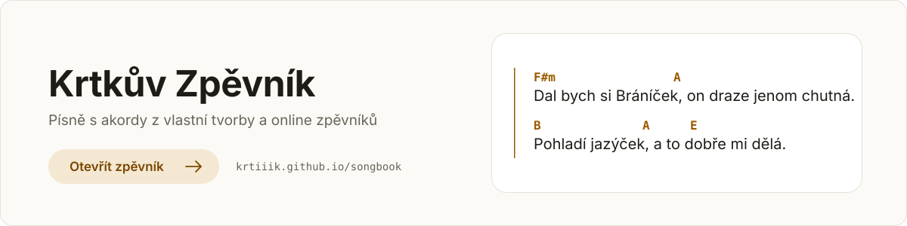

<p align="center">
  <a href="https://krtiiik.github.io/songbook">
    <picture>
      <source media="(prefers-color-scheme: dark)" srcset="docs/banner-dark.svg">
      
    </picture>
  </a>
</p>

# Songbook

My collection of song lyrics with guitar chords, together with songs from
online songbooks ([JRadl](https://zpevnik.jradl.cz), [Bratrův zpěvník](https://bratruvzpevnik.cz)),
published as a website on GitHub Pages and as a PDF.

When a song is in several songbooks, the website shows it once and lets you
switch between the versions.

## Building

```
uv sync
uv run playwright install chromium   # only needed for scraping JRadl
uv run bin/build.py
```

The result is in `dist/`. To build and serve it at http://localhost:8000:

```
bin/build_and_serve.ps1
bin/build_and_serve.ps1 -BuildArgs --no-scrape,--no-pdf   # faster, uses the last scrape
```

`uv run bin/build.py --help` lists all options. Every push to `main` builds and
deploys the site (`.github/workflows/static.yml`).

## Layout

| Path | What |
|---|---|
| `songs/*.cho` | my own songs ([ChordPro](https://www.chordpro.org/chordpro/chordpro-directives/)) |
| `songbook.toml` | site title and song sources: labels, priority, scrapers |
| `songs/.overrides.toml` | manual fixes to matching songs across sources |
| `bin/build.py` | scrapes, matches and writes the website data and PDF |
| `bin/library.py` | loading songs and matching versions of the same song |
| `bin/scraping/` | one scraper per online songbook |
| `web/` | the website: plain HTML, CSS and JavaScript modules, no build step |
| `.cache/sources/` | scraped songs (not committed) |

## Versions of the same song

Songs match when their titles are equal, ignoring case, accents and
punctuation. The version from the first source in `songbook.toml` opens by
default (my own songs, labelled *Krtek*); readers can switch, and their pick is
remembered in their browser. A version can be linked directly as
`#song-id/source-id`.

When matching gets it wrong, fix it in `songs/.overrides.toml`: `merge` joins
songs whose titles differ, `separate` keeps a song apart from same-titled ones.

## Styling

- `web/css/theme.css`: all colors, fonts and sizes (light and dark theme)
- `web/css/base.css`: page layout, top bars, song list, toolbar and panels
- `web/index.html`: the icon sprite (add icons there)
- `web/css/song.css`: the song itself (classes from chordpro-renderer)

## Tests

```
uv run python -m unittest discover tests
node --experimental-detect-module --test tests/
```
